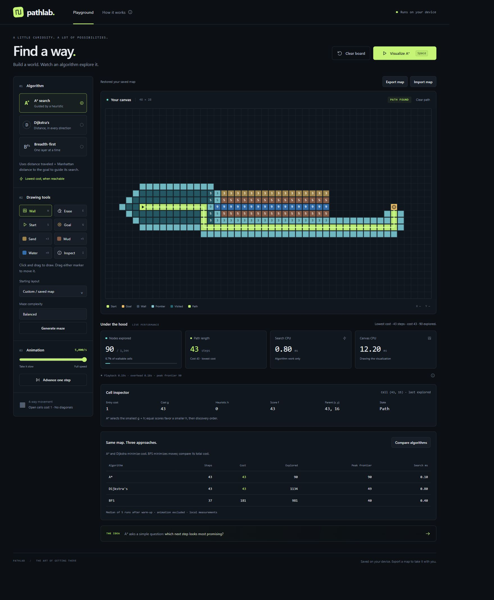

# Pathlab

A dependency-free pathfinding playground with saved maps, weighted terrain, algorithm comparison, maze generation, and an inspector.



Clone the project:

```powershell
git clone https://github.com/Nikhil-4404/pathlab.git
cd pathlab
```

## Run

From this directory:

```powershell
python -m http.server 4173 --bind 127.0.0.1 --directory app
```

Visit http://127.0.0.1:4173. Stop with Ctrl+C. No package install or API key is needed. Classic scripts also permit opening app/index.html directly, but direct-file execution/storage behavior has not been verified because the preview browser blocks file URLs.

## Explore

- Drag to draw walls, erase, or paint sand (3), mud (5), and water (9). Open ground costs 1. Starting on a wall with Wall selected erases the stroke. Right-drag erases.
- Drag a marker to move it. Only its destination clears obstacles/terrain; intervening cells stay intact. Markers cannot overlap.
- Choose an algorithm, play/pause/resume, change speed, or advance one step. Clear path preserves your map. Clear board saves an empty map.
- Keyboard: focus canvas, use arrows/Enter; W/E/S/G select basic tools, 3/5/9 terrain, I Inspect. Space plays/pauses from the canvas/page. Forms/buttons retain normal keyboard behavior.
- Pause and click/Enter to inspect a cell, or choose Inspect. Read g/h/f, parent, entry cost, and state. g counts cost for A*/Dijkstra and moves for BFS; h is only used by A*.
- Choose The costly shortcut to see BFS take fewer moves at greater cost. A* and Dijkstra minimize total cost. Compare algorithms runs the same map and displays median time after warm-up, route moves/cost, explored nodes, and peak frontier entries.
- Generate maze creates connected passages. Complexity controls added connections; Tight has fewer shortcuts. Random barriers can be unreachable.

## Keep maps

Your latest board auto-saves after edits and restores on reload. Algorithm/animation/results are transient. Browser storage is local to the page origin: changing browser/address/port, private browsing, or clearing data may remove/hide it. Use Export map for a portable JSON backup.

Import accepts a file or pasted JSON. Load replaces the board and local save only after full validation. The version-1 format requires the current 48 × 28 dimensions, distinct unit-cost markers, walls, and terrain pairs; only costs 3/5/9 are supported. Unsupported fields, overlaps, duplicates, invalid indexes, malformed JSON, and files above 256 KiB UTF-8 are rejected. Failed imports preserve the map. If automatic saving is unavailable, export remains available.

## Measurements

Search CPU measures setup and search iterator work. Canvas CPU measures synchronous drawing calls, not GPU completion. Playback excludes pauses. Overhead includes pacing, UI updates, and scheduling. Comparison excludes animation and reports median of five measured runs after one warm-up per algorithm, with rotating order. It includes validation and event allocation; it is an approximate browser-local measurement, not a controlled universal benchmark. Peak frontier counts entries, including stale heap entries, not memory bytes.

Costs are paid on entry (starting cell excluded). All moves are orthogonal. A* uses Manhattan distance and favors smaller h on ties. On unit-cost maps, Dijkstra and BFS have identical exploration order. No data is sent to a server; user-triggered export downloads a file.

## Verify

Node is required only for development checks:

```powershell
node --test tests/*.test.cjs
node --check app/app.js
```

See status.md for actual test/browser evidence and outstanding checks. Specifications are in prd.md, requirements.md, techstack.md, flow.md, and frontend.md. This build is local; no external hosting is configured.
